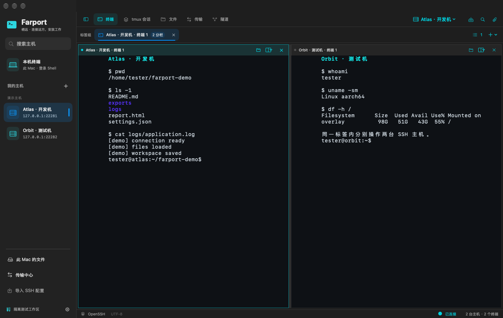
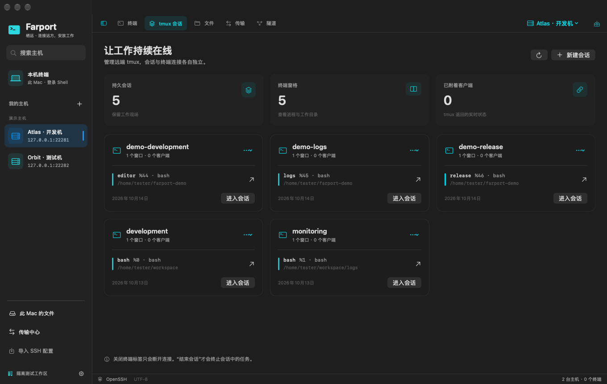
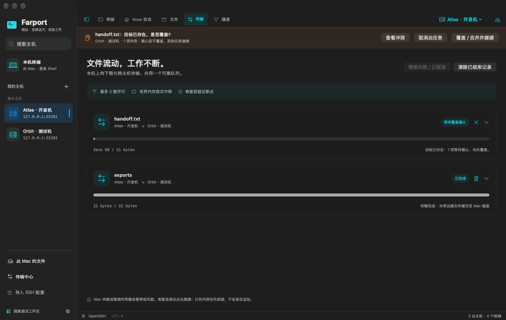
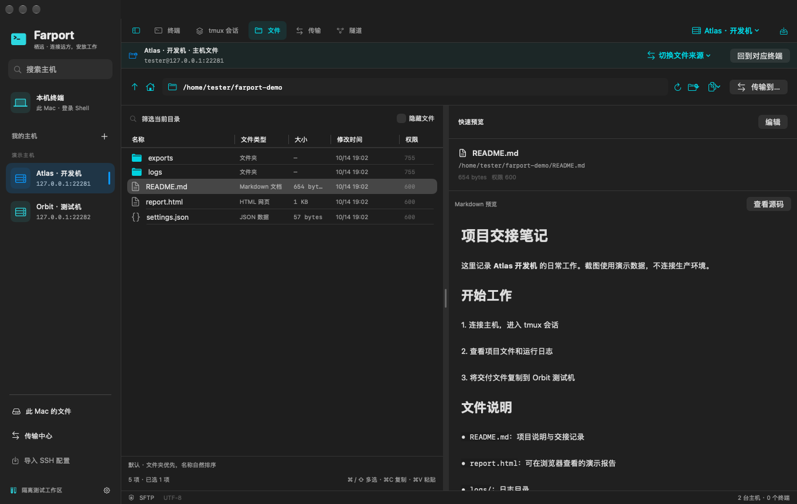
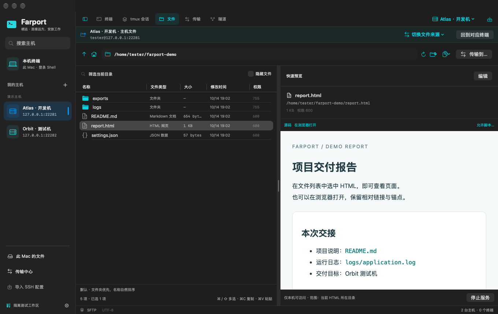

# Farport · 栖远

**SSH terminals, tmux sessions, and remote files in one Mac app.**

[简体中文](README.md) · [Download](https://github.com/boyce-ywr/farport/releases/latest) · [Report an issue](https://github.com/boyce-ywr/farport/issues)

macOS 14+ · Apple Silicon / Intel · [MIT license](LICENSE)

## What you can do

- **Work in multiple terminals.** Connect over SSH or open a local shell. Use tabs and nested splits, drag tabs to reorder them, and collapse the sidebar for more space.
- **Return to your work.** Create, inspect, and attach to local or remote tmux sessions. Closing a terminal tab does not end its tmux session.
- **Move files between machines.** Copy files and folders between your Mac and SSH hosts, or between two SSH hosts. Multi-selection, verified resume, and overwrite confirmation are included.
- **Read and edit remote files.** Preview text, images, Markdown, HTML, and PDF. Edit text and Markdown with conflict checks before saving.
- **Send images to a remote coding agent.** Paste a clipboard image or drag in files. Farport uploads and verifies them, then inserts a path the target machine can read. It does not press Enter for you.

Also included: host groups and colors, SSH config import, jump hosts, port forwarding, terminal search, pinch-to-zoom fonts, and light/dark appearance.

### tmux sessions

Keep long-running tasks in tmux and reconnect later. See sessions, windows, processes, and working directories without leaving the app.

### File transfers

Copy selected items to another file source, or use “Transfer to.” Existing files require confirmation. Folder merges preserve files that exist only at the destination.

### Preview and edit

Read files without downloading them first. Switch Markdown between formatted view and source, use a side-by-side preview while editing, and navigate or zoom PDFs.

Open HTML reports in your browser, too. A temporary localhost address reads the report and relative assets over SFTP—no web server needs to be installed on the remote host. Scripts are disabled by default and can be enabled for a trusted report.

Real application screenshots using isolated demo hosts and files. The current interface is in Chinese.

## Install

Download a DMG from [GitHub Releases](https://github.com/boyce-ywr/farport/releases/latest). Current version: **0.1.6**.

| Mac | Download |
| --- | --- |
| Apple Silicon, including M-series chips | [Apple Silicon](https://github.com/boyce-ywr/farport/releases/download/v0.1.6/Farport-0.1.6-arm64.dmg) |
| Intel | [Intel](https://github.com/boyce-ywr/farport/releases/download/v0.1.6/Farport-0.1.6-x86_64.dmg) |
| Unsure, or need both architectures | [Universal](https://github.com/boyce-ywr/farport/releases/download/v0.1.6/Farport-0.1.6-universal.dmg) |

1. Open the DMG and drag **Farport.app** into **Applications**.
2. Launch Farport from Applications. Save your work and quit the previous version before upgrading.
3. To check your chip, open **Apple menu → About This Mac**. ZIP archives and SHA-256 checksums are also available in each release.

Normal SSH use does not require Swift, Docker, or GitHub CLI. To manage tmux sessions, tmux must be installed on the machine where those sessions run.

> **First launch:** builds are currently ad-hoc signed, without an Apple Developer ID signature or notarization. macOS may block them. After checking the source and checksum, follow [Apple’s official guidance](https://support.apple.com/102445) to review the option in **System Settings → Privacy & Security**. Do not disable system protection. Stop if macOS reports malware or your organization’s policy blocks the app.
>
> Apple Silicon has been tested at runtime. Intel packages have been built and checked, but have not been tested on an Intel Mac. Farport is still in early development.

## Get started

1. Click **+** beside “我的主机” in the sidebar. Add a host address, username, and authentication details, or import an SSH config.
2. Use **测试连接** to check SSH and SFTP, then save and connect. Verify the server fingerprint on first connection.
3. Open **tmux 会话** for persistent sessions or **文件** for files. A local terminal is available directly from the sidebar.

| Action | Shortcut |
| --- | --- |
| New terminal / local terminal | ⌘T / ⌘⇧T |
| Split left–right / top–bottom | ⌘D / ⌘⇧D |
| Switch panes | ⌘[ / ⌘] |
| Maximize or restore a pane | ⌘⇧Enter |
| Toggle sidebar | ⌘⌥S |
| Search terminal output | ⌘F |

## FAQ

**How do updates work?** Download and replace the app from Releases; GitHub CLI is not required for this. Version 0.1.6’s in-app update checker currently requires an authenticated GitHub CLI installation. It verifies the downloaded package and lets you decide when to install—it does not close your terminals automatically.

**Can I use Codex or Claude Code?** You can send images and files to the machine running your agent. The remote Codex + tmux image workflow has been tested; the full Claude Code image-recognition workflow has not been independently verified. Nested SSH, containers, and different users can have separate filesystems, so check that the receiving process can read the uploaded location.

**Where does my data go?** Host settings and transfer records stay on your Mac; credentials use macOS Keychain. Transfers go to the destination you choose. HTML preview URLs listen only on localhost but carry a temporary access token—do not share them. More detail is in the [usage guide](docs/usage.md) (Chinese).

**Is there a Windows version?** Not yet. The current client is macOS-only.

## Feedback and development

Please [open an issue](https://github.com/boyce-ywr/farport/issues) with the app version, macOS version, chip type, and steps to reproduce. Remove credentials, private keys, tokens, and private host details from screenshots and logs.

- [Usage guide](docs/usage.md) (Chinese)
- [Build, tests, and screenshots](docs/development.md) (Chinese)
- [Validation coverage and known limits](docs/validation.md) (Chinese)
- [Release notes](https://github.com/boyce-ywr/farport/releases)

## License and acknowledgments

Farport is [MIT licensed](LICENSE). Use, modification, redistribution, and commercial use are permitted with the required copyright and license notices.

The terminal uses [SwiftTerm](https://github.com/migueldeicaza/SwiftTerm), and SSH uses the copy of OpenSSH included with macOS. Haven inspired parts of the feature set and interaction design; Farport does not copy its source code. See [third-party notices](THIRD_PARTY_NOTICES.md).
