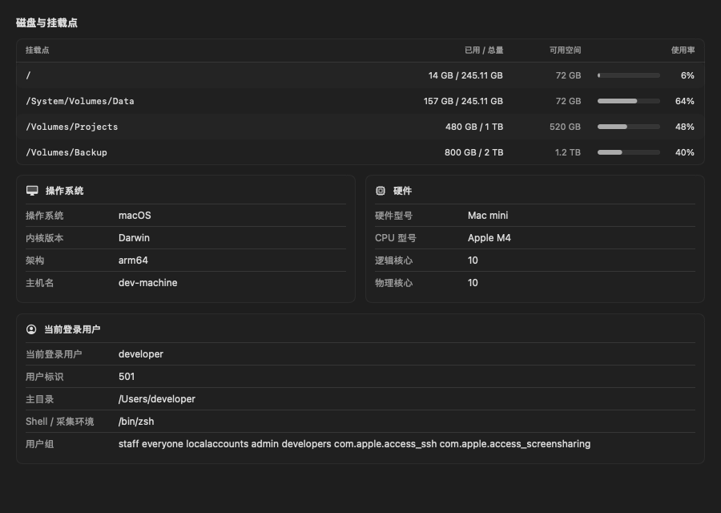
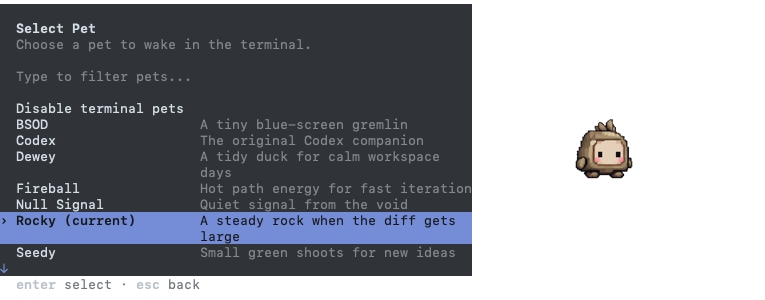

# Farport · 栖远

**SSH terminals, tmux sessions, and remote files in one Mac app.**

[简体中文](README.md) · [Download](https://github.com/boyce-ywr/farport/releases/latest) · [Report an issue](https://github.com/boyce-ywr/farport/issues)

macOS 14+ · Apple Silicon / Intel · [MIT license](LICENSE)

**Preview testing:** The [0.1.11 ARM64 prerelease](docs/releases/0.1.11.md) uses `Farport Preview.app` and a separate configuration directory. It can coexist with the stable app and does not automatically migrate saved hosts. The default download link still points to the stable release.

## What you can do

- **Inspect host health.** View CPU, memory, processes, interface rates, ports, and system/user details without installing an agent. Collection stops when you leave. Linux/macOS have live validation; see release notes for Windows/Termux limitations.

- **Work in multiple terminals.** Connect over SSH or open a local shell. Use tabs and nested splits, drag tabs to reorder them, and collapse the sidebar for more space.
- **Return to your work.** Create, inspect, and attach to local or remote tmux sessions. Closing a terminal tab does not end its tmux session.
- **Move files between machines.** Copy files and folders between your Mac and SSH hosts, or between two SSH hosts. Multi-selection, verified resume, and overwrite confirmation are included.
- **Read and edit remote files.** Preview text, images, Markdown, HTML, PDF, and audio/video. Common source files such as Java, Python, and JSON/XML have syntax highlighting. Edits check for conflicts before saving.
- **Send images to a remote coding agent.** Paste a clipboard image or drag in files. Farport uploads and verifies them, then inserts a path the target machine can read. It does not press Enter for you.

Also included: host groups and colors, SSH config import, jump hosts, port forwarding, terminal search, pinch-to-zoom fonts, and light/dark appearance. The bottom-right status bar shows your Mac's local time in 24-hour format, updated every minute.

Choose English or Simplified Chinese in Settings; it applies and saves immediately, without restarting terminals, transfers, or open edits. Remote output, file contents, and custom host names stay unchanged. The file browser's Back button follows the visit history of each file source.

Monitoring uses a compact disk table and grouped operating-system, hardware, and user details, with less empty space.
Click any process column heading to cycle ascending, descending, and default order. Refreshing preserves your choice, and missing values stay last.

### Codex pets

Regular local and SSH terminals support Codex's built-in pet animations. After updating, open a new terminal, run `codex`, then use `/pets` to choose a pet or `/pets off` to disable it.

**Codex currently disables pets inside tmux and Zellij.** Use “Open regular terminal” on the tmux page to open a direct connection to the same host without stopping its tmux sessions. Custom pets must also match the asset format supported by your Codex CLI version.

### tmux sessions

Keep long-running tasks in tmux and reconnect later. See sessions, windows, processes, and working directories without leaving the app.

### File transfers

Copy selected items to another file source, or use “Transfer to.” Existing files require confirmation. Folder merges preserve files that exist only at the destination. Completed transfers use compact rows: the folder button reveals a download's destination or an upload's local source in Finder. Remote-to-remote transfers have no local Finder action.

### Preview and edit

Read files without downloading them first. Switch Markdown between formatted view and source, use a side-by-side preview while editing, and navigate or zoom PDFs.

The editor toolbar has Save, Undo, Redo, Cut, Copy, Paste, and Select All. **⌘S** saves without closing the editor; a brief “Saved” message lets you keep working. Closing only prompts for unsaved changes. This works for local and remote files, with conflict checks before saving.

Open HTML reports in your browser, too. A temporary localhost address reads the report and relative assets over SFTP—no web server needs to be installed on the remote host. Scripts are disabled by default and can be enabled for a trusted report.

HTML can reference images, CSS, SVG, fonts and media in the same folder or subfolders, such as `src="./cover.png"`, `src="images/photo.png"` and `href="styles/report.css"`. CSS `@import` and `url(...)` resolve relative to the stylesheet. Concurrent resource requests queue instead of being dropped when more than four arrive. This works in both the sidebar and double-click preview. Local JavaScript, modules and JSON data can be used after allowing scripts for a trusted page; files outside the report folder, absolute `file://` URLs and external CDN requests remain blocked.

Real application screenshots using isolated demo hosts and files, shown in Simplified Chinese. An English interface is also available.

## Install

This README describes the main branch. Check each release's notes for the features included in its downloads.

**Update from 0.1.8 build 9**: the current version includes the preview shutdown crash fix.

Download the stable version from [GitHub Releases](https://github.com/boyce-ywr/farport/releases/latest). **The current stable version is 0.1.16 (build 22)**, adding double-click file previews, cut-and-paste moves and native same-machine transfers, improving attachment insertion and fixing concurrent HTML resource loading. See the [release notes (Chinese)](docs/releases/0.1.16.md) for validation coverage, signing and installation limitations.

| Mac | Download |
| --- | --- |
| Apple Silicon, including M-series chips | [Apple Silicon](https://github.com/boyce-ywr/farport/releases/download/v0.1.16/Farport-0.1.16-arm64.dmg) |
| Intel | [Intel](https://github.com/boyce-ywr/farport/releases/download/v0.1.16/Farport-0.1.16-x86_64.dmg) |
| Unsure, or need both architectures | [Universal](https://github.com/boyce-ywr/farport/releases/download/v0.1.16/Farport-0.1.16-universal.dmg) |

1. Open the DMG and drag **Farport.app** into **Applications**.
2. Launch Farport from Applications. Save your work and quit the previous version before upgrading.
3. To check your chip, open **Apple menu → About This Mac**. ZIP archives and SHA-256 checksums are also available in each release.

Normal SSH use does not require Swift, Docker, or GitHub CLI. To manage tmux sessions, tmux must be installed on the machine where those sessions run.

> **First launch:** builds are currently ad-hoc signed, without an Apple Developer ID signature or notarization. macOS may block them. After checking the source and checksum, follow [Apple’s official guidance](https://support.apple.com/102445) to review the option in **System Settings → Privacy & Security**. Do not disable system protection. Stop if macOS reports malware or your organization’s policy blocks the app.
>
> Apple Silicon has been tested at runtime. Intel packages have been built and checked, but have not been tested on an Intel Mac. Farport is still in early development.

## Get started

1. Click **+** beside **My hosts** in the sidebar. Add a host address, username, and authentication details, or import an SSH config.
2. Use **Test connection** to check SSH and SFTP, then save and connect. Verify the server fingerprint on first connection.
3. Open **tmux sessions** for persistent sessions or **Files** for files. A local terminal is available directly from the sidebar.

| Action | Shortcut |
| --- | --- |
| New terminal / local terminal | ⌘T / ⌘⇧T |
| Split left–right / top–bottom | ⌘D / ⌘⇧D |
| Switch panes | ⌘[ / ⌘] |
| Maximize or restore a pane | ⌘⇧Enter |
| Toggle sidebar | ⌘⌥S |
| Search terminal output | ⌘F |
| Save in the editor (keep it open) | ⌘S |
| Undo / redo in the editor | ⌘Z / ⌘⇧Z |
| Cut / copy / paste / select all in the editor | ⌘X / ⌘C / ⌘V / ⌘A |
| Cut (move) / copy / paste in the file list | ⌘X / ⌘C / ⌘V |

## FAQ

**How do I move files?** Select one or more files, press ⌘X (or choose Cut), then press ⌘V in the destination pane. Cutting alone leaves sources untouched. Pasting queues the move and both panes refresh when it completes. Matching connection endpoints use native `cp` / `mv` on that machine, without routing file contents through the Mac. Moves between different endpoints transfer and verify file contents before removing the corresponding source entries. Existing destinations still require confirmation; folder merges preserve extra destination files. Endpoints without POSIX commands, including native Windows shells, continue to use SFTP.

If a move stops or fails, keep the source, destination and `.swb-*.move` staging directories and resume the **original transfer task**. Do not cut again or delete staging files. Completed portions are not automatically undone; avoid editing either location while a move is in progress.

**How do I copy reliably?** Select text and press ⌘C, or use the pane's copy button. In tmux or mouse-aware programs, **Shift-drag, then ⌘C** copies locally without relying on the remote program. Farport confirms “Copied to Mac clipboard”; copying without a local selection does not erase the existing clipboard.

The development branch adds **explicit copying of the current selection in Farport-managed tmux sessions** (not included in 0.1.16). With no local selection, ⌘C, the copy button and the context menu try to read the current tmux selection instead of only waiting for clipboard synchronization. Copy mode and the selection remain intact; old buffers are never used as a substitute. Late results are discarded after input, window, connection or clipboard changes. Use Shift-drag for manually nested tmux, selections already cleared, or older tmux configurations that cannot safely read a selection independently.

**Why does a program say Copied but Paste is wrong?** The program's message does not confirm a Mac clipboard write. Remote writes require permission; blocked or background requests show feedback. Use the pane's clipboard menu to allow and copy pending content. Permission applies only to the current connection and resets on reconnect. Remote clipboard reads remain blocked.

**Can I configure right-clicks and attachments?** The default terminal menu provides copy, paste, and selection. Enable tmux menus in Settings for sessions opened from the app's tmux page. Farport uses tmux's dedicated menu event even when the foreground program captures the mouse; Shift-right-click uses the normal menu. Remote key bindings are not modified. Attachment insertion has a global default and per-host override. Automatic insertion still checks the original target and never presses Enter.

**Can I paste straight into the terminal?** Yes. ⌘V and right-click Paste accept text, clipboard images, and files copied in Finder. Images and files are uploaded and verified before automatic insertion, with no second click. Terminal protocol replies no longer count as typing. Typing during upload, switching targets, or leaving the app in the background still prevents automatic insertion. Multiline text keeps its confirmation prompt.

**How do updates work?** Download and replace the app from Releases; GitHub CLI is not required for this. Version 0.1.8’s in-app update checker currently requires an authenticated GitHub CLI installation. It verifies the downloaded package and lets you decide when to install—it does not close your terminals automatically.

**Can I use Codex or Claude Code?** You can send images and files to the machine running your agent. The remote Codex + tmux image workflow has been tested; the full Claude Code image-recognition workflow has not been independently verified. Nested SSH, containers, and different users can have separate filesystems, so check that the receiving process can read the uploaded location.

**Where does my data go?** Host settings and transfer records stay on your Mac; credentials use macOS Keychain. Transfers go to the destination you choose. HTML preview URLs listen only on localhost but carry a temporary access token—do not share them. More detail is in the [usage guide](docs/usage.md) (Chinese).

**Can I connect to Windows?** The client runs on macOS and can connect to Windows OpenSSH. Native CMD sessions, Chinese input/output, connection tests, and SFTP have live validation. Native Windows shells do not support this tmux manager; use a configured Linux/WSL SSH service for tmux. Farport does not change the default shell. See release notes for validation of other Windows features.

## Feedback and development

Please [open an issue](https://github.com/boyce-ywr/farport/issues) with the app version, macOS version, chip type, and steps to reproduce. Remove credentials, private keys, tokens, and private host details from screenshots and logs.

- [Usage guide](docs/usage.md) (Chinese)
- [Build, tests, and screenshots](docs/development.md) (Chinese)
- [Validation coverage and known limits](docs/validation.md) (Chinese)
- [Release notes](https://github.com/boyce-ywr/farport/releases)

## License and acknowledgments

Farport is [MIT licensed](LICENSE). Use, modification, redistribution, and commercial use are permitted with the required copyright and license notices.

The terminal uses [SwiftTerm](https://github.com/migueldeicaza/SwiftTerm), and SSH uses the copy of OpenSSH included with macOS. Haven inspired parts of the feature set and interaction design; Farport does not copy its source code. See [third-party notices](THIRD_PARTY_NOTICES.md).
